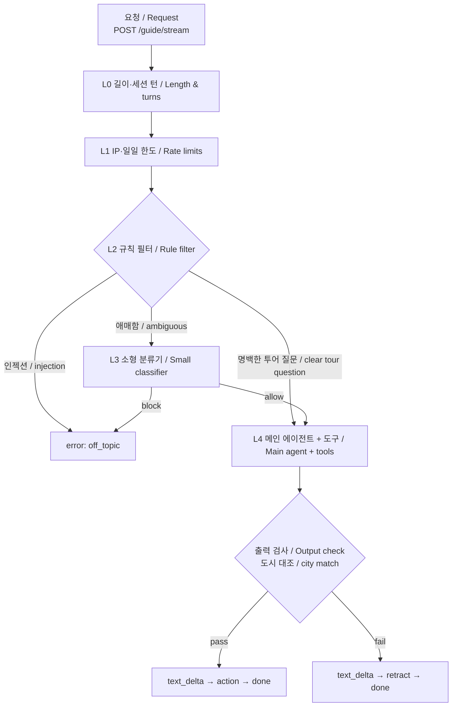

# Stage One Tour Guide Agent

팬이 자연어로 아티스트와 공연을 물으면 실제 데이터를 조회해 답하고, 화면 이동(카메라 이동·투어 페이지 열기·도시 강조)을 데이터로 돌려주는 **투어 가이드 에이전트 API**입니다. [STAGE.ONE (on-stage)](https://github.com/areumz/on-stage) A탭의 가이드 패널과 연동되는 Python(FastAPI, OpenAI Agents SDK) 백엔드입니다.

A **tour-guide agent API**: fans ask about artists and shows in natural language, and it answers from real data and returns screen actions (move the camera, open a tour page, highlight a city) as data. It is the Python (FastAPI, OpenAI Agents SDK) backend for the guide panel in the A tab of [STAGE.ONE (on-stage)](https://github.com/areumz/on-stage).

* * *

## 데모 / Demo

<!-- 스크린샷·GIF 를 넣을 자리 / Place screenshots or GIFs here -->

> 🔗 **라이브 데모 / Live demo**: [on-stage-nine.vercel.app](https://on-stage-nine.vercel.app/)
> 화면의 "투어 가이드" 패널에서 질문할 수 있습니다. 로그인은 필요 없습니다.
> Ask from the "Tour Guide" panel on the page. No login is required.

프론트엔드(on-stage)에서 사용합니다. 이 저장소는 API 서비스만 포함합니다.
The frontend lives in on-stage; this repository contains only the API service.

* * *

## 소개 / Introduction

**데이터가 사실을 말하고, 규칙이 먼저 막고, 화면 이동은 검증된 값만 보냅니다.**

**Data states the facts, cheap rules block first, and only validated values drive the screen.**

- **조회한 사실로만 답변**: 아티스트·공연 데이터는 on-stage `GET /api/artists`에서 읽고, 날짜 계산(D-n)은 서버가 합니다. LLM은 도구 결과에 없는 공연·도시·날짜를 지어내지 않도록 제한됩니다.
- **화면 이동을 데이터로**: `focusArtist`(카메라 이동), `openTour`(투어 페이지), `highlightCity`(도시 강조)를 답변 끝에 `action` 이벤트로 한 번 보냅니다. 서버는 `slug`·도시 코드를 enum으로 검증해서 보냅니다.
- **값싼 검사를 앞에**: 길이·IP 한도 → 규칙 필터 → 소형 분류기 → 메인 에이전트 순서라, 차단된 요청은 도구 호출 없이 끝납니다.
- **한·영 Q&A와 후속 질문**: 질문한 언어로 답하고, 같은 세션의 최근 6턴을 기억합니다. 대화는 서버 메모리에만 있고 저장하지 않습니다.

<br>

- **Answers only from looked-up facts**: artist and show data comes from on-stage `GET /api/artists`, and date math (D-n) is done server-side. The LLM is constrained not to invent shows, cities, or dates that the tools did not return.
- **Screen actions as data**: `focusArtist` (move camera), `openTour` (tour page), and `highlightCity` are sent once at the end of an answer as an `action` event, with `slug` and city codes validated against enums.
- **Cheap checks first**: length and IP limits, then a rule filter, then a small classifier, then the main agent, so blocked requests end without any tool call.
- **Korean/English Q&A with follow-ups**: it answers in the language asked and remembers the last 6 turns of a session. Conversations live in server memory only and are not stored.

* * *

## 워크플로우 / Workflow



- 스트림 순서는 `text_delta… → action? → done`입니다. 출력 검사에 실패하면 `retract`로 답변을 거두고 액션은 보내지 않습니다.
- The stream order is `text_delta… → action? → done`. If the output check fails, the answer is withdrawn with `retract` and no action is sent.
- 같은 세션에 답변 중인 요청이 있으면 `busy`, 한 세션이 20턴을 넘기면 `session_limit`입니다.
- A second request in a session that is still answering gets `busy`; a session past 20 turns gets `session_limit`.
- 안내 문구는 서버가 만들지 않습니다. 프런트가 `error.code`로 ko/en 사전에서 표시합니다.
- The server never writes user-facing notices; the frontend renders them from `error.code`.

* * *

## 기술 스택 / Tech Stack

| 영역 / Area | 선택 / Choice |
| --- | --- |
| 에이전트 / Agent | OpenAI Agents SDK (`openai-agents`) |
| 언어 / Language | Python ≥ 3.12 |
| API | FastAPI + Uvicorn (SSE 스트리밍 / streaming) |
| 모델 / Model | `gpt-4.1-mini` — 메인·분류기, 환경 변수로 교체 / main & classifier, swappable by env |
| 데이터 / Data | on-stage `GET /api/artists` (5분 캐시, 실패 시 마지막 캐시 / 5-min cache, stale on failure) |
| 계약 / Contract | `contracts/` — Pydantic 모델 + 골든 fixture / Pydantic models + golden fixtures |
| 테스트·린트 / Test & Lint | pytest, ruff, GitHub Actions |
| 배포 / Deploy | Google Cloud Run (asia-northeast3, 서울 / Seoul) |
| 패키지 관리 / Packaging | uv |

* * *

## 로컬 실행 / Local Development

```bash
uv sync                                    # 의존성 설치 / install deps
cp .env.example .env                       # 값 채우기 / fill in values
PYTHONPATH=src:. uv run --env-file .env uvicorn --factory tour_guide.main:build_app --port 8000
```

1. `.env`에 `OPENAI_API_KEY`를 채웁니다. 운영과 다른 본인의 키를 쓰세요.
2. `PYTHONPATH=src:.`는 editable 설치에 의존하지 않기 위한 것입니다. macOS에서 venv의 `.pth` 파일에 `hidden` 플래그가 붙으면 `ModuleNotFoundError: tour_guide`가 나는데, 영구 해결은 `chflags nohidden .venv/lib/python*/site-packages/*.pth`입니다.
3. on-stage 로컬과 연동하려면 on-stage의 `NEXT_PUBLIC_GUIDE_API_URL=http://localhost:8000`을 설정합니다(비우면 패널이 나타나지 않습니다). 이 저장소의 `ALLOWED_ORIGINS` 기본값은 `http://localhost:3000`입니다.

<br>

1. Fill in `OPENAI_API_KEY` in `.env`. Use your own key, separate from production.
2. `PYTHONPATH=src:.` avoids relying on an editable install. On macOS a `hidden` flag on the venv `.pth` file can cause `ModuleNotFoundError: tour_guide`; the lasting fix is `chflags nohidden .venv/lib/python*/site-packages/*.pth`.
3. To connect a local on-stage, set `NEXT_PUBLIC_GUIDE_API_URL=http://localhost:8000` there (an empty value hides the panel). `ALLOWED_ORIGINS` defaults to `http://localhost:3000` here.

동작 확인 / Quick check:

```bash
curl -s localhost:8000/health

curl -N -s localhost:8000/guide/stream \
  -H 'content-type: application/json' \
  -d '{"requestId":"r1","sessionId":"s1","locale":"ko","message":"AURORA 투어 일정 보여줘","context":{"view":"orbit"}}'
```

### 테스트 / Tests

```bash
uv run ruff check .
uv run pytest -q                                            # 기본: LLM 호출 없음 / no LLM calls
uv run --env-file .env pytest -m llm -q                     # 실제 LLM 호출, 비용 발생 / real LLM calls (costs money)
uv run --env-file .env python scripts/measure_actions.py    # 액션 판단 8회 측정 / action selection, 8 runs each
```

LLM 출력은 같은 입력에도 흔들리므로 "3회 중 2회", "8회 중 6회"처럼 횟수 기준을 둡니다. 가드레일(분류기·출력 검사)과 액션 판단은 이 방식으로 검증했고, 측정 결과는 [docs/design.md](docs/design.md) §6.4에 있습니다.

LLM output varies run to run, so pass criteria are counted ("2 of 3", "6 of 8"). Guardrails (classifier, output check) and action selection are verified this way; measurements are in [docs/design.md](docs/design.md) §6.4.

* * *

## API

요청·이벤트·액션의 정확한 모양과 예시는 [`contracts/`](contracts)가 기준입니다.
The exact request, event, and action shapes live in [`contracts/`](contracts).

| 메서드 / Method | 경로 / Path | 설명 / Description |
| --- | --- | --- |
| POST | `/guide/stream` | 질문하고 SSE로 답변 받기 / ask a question and stream the answer over SSE |
| GET | `/health` | 외부·LLM 호출 없는 가벼운 확인. 패널을 열 때 콜드 스타트를 깨우는 용도 / lightweight check; warms a cold instance when the panel opens |

### 요청 본문 / Request body

| 필드 / Field | 설명 / Description |
| --- | --- |
| `requestId` | 클라이언트 UUID(`^[A-Za-z0-9_-]{1,64}$`), 로그 상관관계용 / client UUID for log correlation |
| `sessionId` | 브라우저 세션 UUID. 서버는 신뢰하지 않음 / browser session UUID, not trusted by the server |
| `locale` | `ko` / `en`. 기본 응답 언어 / default answer language |
| `message` | 사용자 질문, 200자 초과 시 `too_long` / the question; over 200 chars gives `too_long` |
| `context` | 선택. `{ view: "orbit" \| "tour", slug?, section? }` 현재 화면 / optional current screen |

### SSE 이벤트 / SSE events

POST 본문이 있어 `EventSource`가 아니라 `fetch` 스트리밍으로 읽어야 합니다. Read it with `fetch` streaming, not `EventSource`, because the request is a POST.

| 이벤트 / Event | 페이로드 / Payload |
| --- | --- |
| `tool_status` | `{ tool, key }` — 조회 중 표시용 사전 키 / dictionary key for "looking up…" |
| `text_delta` | `{ text }` — 스트리밍 답변 / streamed answer |
| `action` | `{ type, … }` — `focusArtist` · `openTour` · `highlightCity`, 답변 끝에 한 번 / once at the end |
| `retract` | `{ reason }` — 답변을 거두고 고정 문구로 교체 / withdraw the answer |
| `error` | `{ code }` — `rate_limited` · `off_topic` · `too_long` · `busy` · `session_limit` · `upstream` · `internal` (종료 이벤트, `done` 없음 / terminal, no `done`) |
| `done` | `{}` — 정상 종료 / normal end |

### 환경 변수 / Environment variables

| 변수 / Variable | 기본값 / Default | 설명 / Description |
| --- | --- | --- |
| `ONSTAGE_URL` | (필수 / required) | on-stage 주소 / on-stage base URL |
| `OPENAI_API_KEY` | (필수 / required) | 이 에이전트 전용 키, 운영은 Secret Manager / dedicated key; Secret Manager in prod |
| `ALLOWED_ORIGINS` | `http://localhost:3000` | CORS 허용 Origin, 쉼표 구분, `*` 금지, 끝의 `/`는 제거됨 / comma-separated, no `*`, trailing `/` stripped |
| `ALLOWED_ORIGIN_REGEX` | - | 프리뷰 도메인 패턴 / preview domain pattern |
| `OPENAI_MODEL` · `CLASSIFIER_MODEL` | `gpt-4.1-mini` | 메인·분류기 모델 / main and classifier models |
| `OPENAI_TEMPERATURE` | - | 비우면 모델 기본값 / empty uses model default |
| `TRUSTED_PROXY_HOPS` | `1` | `X-Forwarded-For` 오른쪽에서 몇 번째를 클라이언트 IP로 볼지 / which hop from the right is the client IP |
| `RATE_PER_MINUTE` · `RATE_PER_IP_DAILY` · `GLOBAL_DAILY` | `5` · `30` · `1000` | IP 분당·일일, 전체 일일 요청 한도 / per-IP per-minute & daily, global daily |
| `SESSION_TTL_SECONDS` · `SESSION_MAX` | `1800` · `500` | 세션 유휴 만료, 최대 개수(LRU) / session idle TTL, max count (LRU) |
| `HISTORY_TURNS` · `SESSION_TURN_LIMIT` | `6` · `20` | 세션당 저장 턴, 세션 턴 상한 / stored turns, per-session turn cap |
| `TRACING_ENABLED` | `false` | 운영에서는 끈다(대화 미저장 원칙) / off in prod (conversations are not stored) |

한도 수치는 시작값이고 카운터는 서버 메모리라 재시작 시 초기화됩니다(best-effort 방어, 최종 상한은 선불 크레딧 잔액).
Limits are starting values and counters live in server memory, so they reset on restart (best-effort; the final cap is a prepaid credit balance).

* * *

## 배포 / Deployment

Google Cloud Run 한 대(최대 인스턴스 1, 유휴 시 0대, 서울)에 올립니다. 세션·한도 카운터가 서버 메모리라 인스턴스를 1대로 고정합니다. 시크릿은 Secret Manager로만 주입합니다. 유휴 뒤 첫 요청은 콜드 스타트로 느릴 수 있어, 프런트가 패널을 열 때 `GET /health`로 미리 깨웁니다.

Runs as a single Cloud Run instance in Seoul (max 1, scale-to-zero) because sessions and counters are in server memory. Secrets are injected via Secret Manager only. The first request after idle can be slow (cold start), so the frontend calls `GET /health` when the panel opens to warm it.

- [docs/deploy.md](docs/deploy.md) — 배포 절차·배포 후 확인 / deploy steps & post-deploy checks
- [docs/handoff-onstage.md](docs/handoff-onstage.md) — on-stage 인수인계 / on-stage handoff

* * *

## 개발 프로세스 / Development Process

설계 → 단계별 구현 계획 → 테스트 먼저 구현 → 실제 모델 확인 순서로 진행했습니다. 에이전트와 on-stage의 경계는 `contracts/`의 계약 파일과 골든 fixture로 맞췄습니다. 설계 전문은 [docs/design.md](docs/design.md)에 있습니다.

Design → per-stage implementation plans → tests first → verification against the real model. The boundary with on-stage is held by the contract files and golden fixtures in `contracts/`. The full design is in [docs/design.md](docs/design.md).

1. Q&A·SSE·기본 한도 / Q&A, SSE, basic limits — [plan](docs/superpowers/plans/tour-guide-agent-stage1-answer.md)
2. UI 액션 / UI actions — [plan](docs/superpowers/plans/tour-guide-agent-stage2b-actions.md)
3. 가드레일 / Guardrails — [plan](docs/superpowers/plans/tour-guide-agent-stage3-guardrails.md)
4. 세션·`busy`·`highlightCity` / Sessions, `busy`, `highlightCity` — [plan](docs/superpowers/plans/tour-guide-agent-stage4-session.md)
5. 배포 / Deployment — [guide](docs/deploy.md)

* * *

## 폴더 구조 / Folder Structure

```
├── src/tour_guide/
│   ├── main.py             # 앱 조립 / app wiring
│   ├── api.py              # FastAPI 엔드포인트, 처리 순서 / endpoints, request order
│   ├── agent.py            # 에이전트, 도구, 프롬프트, 스트림 / agent, tools, prompt, stream
│   ├── guard.py            # L0·L2 규칙 필터, 출력 검사 / rule filter, output check
│   ├── classifier.py       # L3 소형 분류기 / small classifier
│   ├── limits.py           # IP 한도, 세션 저장소 / rate limiter, session store
│   ├── tools.py, data.py   # 읽기 도구, on-stage 데이터·캐시 / read tools, data & cache
│   └── settings.py         # 환경 변수 / environment settings
├── contracts/              # on-stage 와 공유하는 계약·fixture / shared contract & fixtures
├── docs/                   # 설계, 계획, 배포·인수 문서 / design, plans, deploy, handoff
├── scripts/                # 액션 판단 측정 / action selection measurement
├── tests/
├── Dockerfile
└── pyproject.toml
```

* * *

## 알려진 제한사항 / Known Limitations

- 출력 검사는 도시 코드·이름만 대조합니다. 날짜·트랙명·투어명 대조와 사전에 없는 도시는 잡지 못합니다.
- 아티스트 이름을 섞은 이탈 질문이나 영어 단어와 겹치는 이름("aurora borealis")은 규칙 필터를 통과해 메인 프롬프트의 거절에 의존합니다(확률적).
- 세션·한도 카운터는 서버 메모리라 재시작 시 사라지고, 인스턴스는 1대로 고정입니다.
- 도시 목록은 on-stage의 대표 도시(`cities[]`)만 알 수 있어 "대표 도시"로 답합니다. 전체 공연 목록은 on-stage에 읽기 엔드포인트가 생기면 전환합니다.
- 분류기는 "의심스러우면 통과"라서 일부 이탈 질문은 메인까지 가서 모델 호출 비용이 듭니다(한도와 잔액이 상한).

<br>

- The output check compares city codes and names only; it cannot catch dates, track or tour names, or cities missing from the table.
- Off-topic questions that mention an artist, or names that collide with English words ("aurora borealis"), pass the rule filter and rely on the main prompt's refusal (probabilistic).
- Sessions and counters are in memory and reset on restart; the service is pinned to one instance.
- Only on-stage's featured cities (`cities[]`) are known, so city lists are answered as "featured cities" until a full-shows read endpoint exists.
- The classifier passes when in doubt, so some off-topic questions reach the main model; limits and the prepaid balance bound the cost.

* * *

## 라이선스 / License

[MIT](LICENSE)
