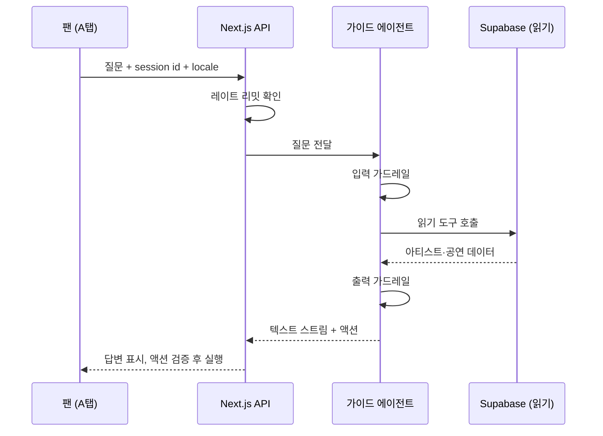

# 투어 가이드 에이전트 기획서

Sep 18, 2026 · @AREUM

## 1. 개요

팬이 A탭에서 자연어로 질문하면, 에이전트가 아티스트·공연 데이터를 조회해 답하고 궤도 카메라를 해당 아티스트로 이동시킨다. 무대 연출 에이전트 이후 착수한다.

| 항목 | 내용 |
| --- | --- |
| 프로젝트명 | 투어 가이드 에이전트 (가칭) |
| 대상 | STAGE.ONE A탭 (`/` 레이블 궤도, `/artists/[slug]` 투어 페이지) |
| 사용자 | 익명 팬 (로그인 없음) |
| 목적 | 대화형 탐색 + UI 내비게이션. 답변만 하지 않고 화면을 움직인다 |
| 프레임워크 | OpenAI Agents SDK |
| 착수 시점 | 무대 연출 에이전트 이후 |

무대 연출 에이전트와의 차이

|  | 무대 연출 에이전트 | 투어 가이드 에이전트 |
| --- | --- | --- |
| 사용자 | 로그인한 스태프 | 익명 팬 |
| 문제 형태 | 사람 승인으로 멈추는 상태형 워크플로우 | 짧은 대화 + 읽기 전용 도구 |
| 쓰기 | 있음 (시퀀스 저장) | 없음 |
| 핵심 요구 | interrupt, 부분 재생성 | 응답 속도, 가드레일, 비용 방어 |
| 프레임워크 | LangGraph | OpenAI Agents SDK |

## 2. 프레임워크 선택 근거

OpenAI Agents SDK를 쓴다. 이 에이전트에 필요한 세션 메모리·스트리밍·가드레일을 기본 기능으로 갖고, 불필요한 그래프 구조가 없다.

| 후보 | 판단 | 이유 |
| --- | --- | --- |
| OpenAI Agents SDK | 선택 | 도구 호출, 세션 메모리, 스트림 이벤트, 입출력 가드레일, 트레이싱 내장. 공개 대화형에 맞음 |
| LangGraph | 과함 | interrupt·상태 그래프가 필요 없는 문제. 쓰지 않을 구조를 짊어짐 |
| Google ADK | 차선 | 대화형 강점은 있으나 가드레일 레퍼런스(강의 #9)가 Agents SDK 쪽에 있음 |
| CrewAI · AutoGen | 부적합 | 멀티 에이전트 협업용. 응답 지연과 비용이 커짐 |
| 프레임워크 없이 직접 | 가능 | 도구 목록이 작아 #2 수준으로도 됨. 단 가드레일·세션을 직접 구현해야 함 |

포트폴리오 관점: "사람 승인이 필요한 상태형 워크플로우는 LangGraph, 공개 대화형 에이전트는 OpenAI Agents SDK"처럼 문제 형태에 따라 도구를 골랐다는 설명이 된다. 다른 모델(Claude, Gemini)을 쓸 경우 SDK의 모델 어댑터 지원 범위를 착수 시점에 확인한다.

## 3. 사용자 시나리오

답변과 화면 이동이 항상 같이 일어난다.

| 팬의 질문 | 호출 도구 | 답변 | UI 액션 |
| --- | --- | --- | --- |
| 9월에 도쿄 오는 아티스트 있어? | `searchShows(city, month)` | 해당 아티스트와 날짜 | 궤도에서 그 아티스트 노드 포커스 |
| 몽환적인 노래 하는 팀 추천해줘 | `listArtists()` | 장르·무드 기반 추천 1\~2팀 | 추천 아티스트 포커스 |
| AURORA 투어 일정 보여줘 | `getArtist(slug)` | 요약(24개 도시 등) | `/artists/aurora` 투어 섹션으로 이동 |
| 서울 공연 다음엔 어디야? (이어지는 질문) | `getArtist(slug)` | 세션 메모리로 맥락 유지해 다음 도시 안내 | 투어 궤도에서 해당 도시 노드 강조 |
| 오늘 점심 뭐 먹지? | 없음 | 가드레일이 차단, 투어 관련 질문 유도 | 없음 |

영어로 물어도 같은 도구와 액션을 쓰고, 답변 언어만 질문 언어를 따른다. 예: "Who's playing in Tokyo in September?" → `searchShows`로 조회해 영어로 답하고 같은 노드를 포커스한다.

## 4. 도구 설계

도구는 읽기 전용이고, 화면 조작은 에이전트가 직접 하지 않고 "액션 데이터"로 돌려준다.

### 읽기 전용 도구 (서버 실행)

| 도구 | 입력 | 데이터 출처 |
| --- | --- | --- |
| `listArtists` | 없음 | 기존 `/api/artists` (이름, 장르, 컨셉) |
| `getArtist` | `slug` (enum) | 기존 아티스트·투어 데이터 |
| `searchShows` | `city?`, `month?`, `artist?` | 기존 공연 테이블 |

### UI 액션 (프론트 실행)

| 액션 | 페이로드 | 화면 동작 |
| --- | --- | --- |
| `focusArtist` | `{ slug }` | 레이블 궤도 카메라를 해당 노드로 회전·확대 |
| `openTour` | `{ slug, section? }` | `/artists/[slug]`로 이동, 투어 섹션으로 스크롤 |
| `highlightCity` | `{ slug, city }` | 투어 궤도에서 도시 노드 강조 |

규칙

- `slug`·`city`는 실제 데이터에서 만든 enum으로 검증한다. 프론트도 액션을 실행하기 전에 한 번 더 검증한다(`mergeStageState`와 같은 원칙).
- 프론트는 모르는 액션 타입을 무시한다. 액션 하나가 실패해도 답변 텍스트는 보여준다.
- 쓰기 도구는 만들지 않는다. 예매·결제는 README의 알려진 제한사항대로 범위 밖이다.
- 도구 입력과 UI 액션은 언어와 무관한 코드(`slug`, `city`)로만 주고받는다. "도쿄"·"Tokyo" 같은 사용자 표기는 에이전트가 코드로 바꿔 호출한다.
- 데이터는 지금 한국어 값 그대로 반환하고, 곡명·투어명 같은 고유명사는 번역하지 않는다. 나중에 데이터를 번역하면 도구에 `locale`을 추가하는 것으로 끝난다.

## 5. 대화 흐름

입력 가드레일 → 도구 호출 → 출력 가드레일을 거쳐, 텍스트는 스트리밍하고 액션은 마지막에 한 번 실행한다.

대화 맥락은 세션 메모리로 유지하되, 익명 사용자라 세션은 브라우저 단위 임시 id로 두고 짧게 만료시킨다. 대화 내용은 별도로 저장하지 않는다.

언어는 프론트가 요청에 `locale`(`ko`/`en`)을 함께 보내 정한다. 기본값은 브라우저 언어(영어면 `en`, 그 외 `ko`)이고, 패널의 KO|EN 스위치로 바꿀 수 있다. 에이전트는 `locale`을 동적 지시문에 넣어 기본 응답 언어로 쓰고, 사용자가 다른 언어로 물으면 그 언어로 답한다. 한도 초과·오류·주제 이탈 안내와 추천 질문 칩은 LLM이 만들지 않고, 프론트의 ko/en 사전에서 `locale`에 맞춰 보여준다.

## 6. 가드레일과 보안

로그인 없는 공개 탭이라, 무대 에이전트보다 방어가 더 중요하다.

| 위협 | 방어 | 위치 |
| --- | --- | --- |
| 비용 남용 (반복 호출) | IP 기준 레이트 리밋, 전체 일일 호출 한도, 입력 길이 제한, 한도 초과 시 안내 문구 | Next.js API |
| 주제 이탈 (범용 챗봇처럼 사용) | 입력 가드레일로 투어·아티스트 밖 질문 차단 | 에이전트 |
| 프롬프트 인젝션 | 도구가 읽기 전용이라 피해 범위가 작음. 시스템 프롬프트 노출·역할 변경 시도는 입력 가드레일에서 차단 | 에이전트 |
| 다른 언어로 우회 (주제 이탈·인젝션) | 입력 가드레일을 한국어·영어 모두에서 테스트한다. 도시·날짜는 코드로 대조하므로 출력 가드레일은 언어와 무관 | 에이전트 |
| 없는 공연 지어내기 | 출력 가드레일에서 답변의 도시·날짜가 도구 결과에 있는지 확인 | 에이전트 |
| 잘못된 UI 액션 | enum 검증, 모르는 액션 무시 | 에이전트 + 프론트 |
| 키 노출 | LLM 키와 Supabase 키는 서버 전용, 도구는 anon 수준 읽기만 | 서버 |

가드레일 자체도 LLM 호출이라 비용이 늘어난다. 입력 가드레일은 작고 싼 모델로, 출력 가드레일은 규칙 기반 검사를 우선 검토한다.

## 7. 아키텍처와 배포 위치

기본안은 무대 에이전트용 Python 서비스에 엔드포인트를 추가하는 것이고, 응답 지연이 문제가 되면 TS 버전으로 Next.js 안에 둔다.

| 안 | 구성 | 장점 | 단점 |
| --- | --- | --- | --- |
| A. Python 서비스 공유 (기본) | 기존 FastAPI에 `/guide` 추가, OpenAI Agents SDK(Python) | 인프라 추가 없음, 강의 코드와 동일 언어 | 한 단계 더 거치는 지연, 콜드 스타트가 공개 탭에 노출 |
| B. Next.js 내장 | Route Handler + OpenAI Agents SDK(TS) | 지연 최소, Vercel에서 바로 스트리밍 | Python으로 배운 내용을 TS로 옮겨야 함 |

결정 기준: A안으로 만든 뒤 첫 응답까지 시간이 데모에서 거슬리면 B안으로 옮긴다. 도구 이름·액션 스키마를 언어 중립적인 JSON 스키마로 정의해두면 이전 비용이 작다.

데이터는 기존 `/api/artists` 등 Next.js 엔드포인트를 통해 읽는다. 에이전트가 Supabase에 직접 접근하지 않아 "클라이언트는 API Routes 경유"라는 기존 원칙을 지킨다.

## 8. UX와 A탭 무드 보존

A탭의 몰입형 다크 무드를 해치지 않는 것이 기능보다 우선이다.

- 기본 상태는 접힌 작은 입력 버튼. 열면 반투명 다크 패널이 나타나고, 3D 씬을 가리는 면적을 최소화한다.
- 포인트는 답변 텍스트보다 화면 이동이다. 궤도 카메라가 부드럽게 회전하는 장면이 데모 포인트다.
- 카메라 이동 애니메이션은 ref + `useFrame`으로 처리한다. React state를 프레임마다 바꾸면 v2.2에서 겪은 Canvas 재구성 문제가 재현된다.
- 모바일(반응형 완료 상태)에서는 하단 시트로 열어 무대 툴 컨트롤 패널과 같은 패턴을 따른다.
- 추천 질문 칩 2\~3개를 두어 처음 쓰는 팬도 바로 해볼 수 있게 한다.

## 9. MVP 단계

| 단계 | 범위 | 완료 기준 |
| --- | --- | --- |
| 1. 답변만 | 읽기 도구 3개 + 스트리밍 답변, 레이트 리밋·일일 한도, locale 전달(브라우저 언어 자동 감지), 고정 문구 ko/en 사전 | 시나리오 표의 질문에 실제 데이터로 답함, 영어 질문에는 영어로 답함 |
| 2a. 3D 궤도 전환 | A탭 메인 궤도를 3D로 교체. 에이전트 연결 없이 진행. 방식(WebGL / CSS 3D)은 시작 전 코드에서 확인 | 기존 hover·클릭 진입과 모바일 반응형이 그대로 동작, 프레임 끊김 없음, 문제 시 2D로 되돌릴 수 있음 |
| 2b. UI 액션 | `focusArtist`, `openTour` + 프론트 검증·실행 | 답변과 함께 카메라 이동, `webglcontextlost` 0건 (WebGL 방식일 때) |
| 3. 가드레일 | 입력·출력 가드레일 | 주제 이탈·없는 공연 질문 테스트 세트 통과 (한국어·영어 각각) |
| 4. 대화 맥락 | 세션 메모리, `highlightCity`, 추천 질문 칩, KO\|EN 스위치 | 이어지는 질문에 맥락 유지, 스위치로 패널 문구와 기본 응답 언어 전환 |
| 5. 배포 | A안 배포, 지연 측정 후 필요하면 B안 이전, 한·영 README | 배포 환경에서 첫 응답 지연 측정·기록 |

가드레일(3단계)은 공개 배포 전 필수다. 1\~2b단계는 로컬에서만 돌린다.

## 10. 리스크 및 대응

| 리스크 | 대응 |
| --- | --- |
| 공개 탭 비용 폭증 | IP 레이트 리밋, 전체 일일 한도, 한도 초과 시 안내 문구와 추천 질문 칩만 노출 |
| 콜드 스타트로 첫 응답 지연 | 지연 측정 후 B안(Next.js 내장)으로 이전 |
| 없는 공연 정보 생성 | 답변의 도시·날짜를 도구 결과와 대조하는 출력 가드레일 |
| 입력창이 A탭 몰입감을 해침 | 기본 접힘, 반투명 다크 패널, 화면 이동 중심 UX |
| 카메라 애니메이션이 WebGL 문제 재현 (WebGL 방식일 때) | ref + `useFrame`, state는 이동 완료 시에만 커밋 |
| 3D 궤도 교체가 기존 A탭 동작을 깨뜨림 | 2a에서 에이전트와 분리해 먼저 검증. 액션이 { slug } 데이터라 렌더러와 무관해서, 3D가 지연되면 2D 회전 방식으로 2b를 먼저 진행 |
| 3D 방식 미정 (WebGL / CSS 3D) | 2a 시작 전 현재 메인 구현을 코드로 확인. CSS 3D면 webglcontextlost 기준 대신 프레임 끊김·모바일 성능으로 완료 기준을 바꾼다 |
| 가드레일 호출로 비용·지연 증가 | 작은 모델 또는 규칙 기반 검사 우선 |

## 11. 선수강 목록 (AI Agents 마스터클래스)

무대 연출 에이전트에서 #0·#1·#2를 이미 들었다는 전제로, 추가 필수는 약 2시간이다.

### 필수 (구현 시작 전)

| 챕터 | 분량 | 이 기획에서 쓰이는 곳 |
| --- | --- | --- |
| #7 OpenAI Agents SDK 기초 (7.0\~7.7) | 약 56분 + 7.0 | Agents and Runners, Stream Events(스트리밍 답변), Session Memory(대화 맥락), Structured Outputs(UI 액션 스키마), Tracing |
| #8.0\~8.1 Chat UI · Conversation History | 약 21분 | 대화 기록 처리 방식. UI는 Next.js로 따로 만든다 |
| #9.1\~9.3 Context · Dynamic Instructions · Input Guardrails | 약 30분 | 현재 페이지(어느 아티스트인지)를 지시문에 주입, 주제 이탈·인젝션 차단 |
| #9.7 Output Guardrails | 약 10분 | 없는 공연 정보 차단 |

### 선택

| 챕터 | 분량 | 들어야 할 시점 | 이유 |
| --- | --- | --- | --- |
| #9.6 Hooks | 약 7분 | 3단계 전 | 도구 호출 로깅·비용 추적 |
| #9.4\~9.5 Handoffs · Handoff UI | 약 26분 | 에이전트를 나눌 때 | "투어 안내"와 "아티스트 추천"을 분리하는 확장 시 |
| #17 Testing Agents | 약 45분 | 공개 배포 전 | 가드레일 테스트 세트. 무대 에이전트에서 들었다면 생략 |
| #21 Deploying Agents | 약 40분 | 5단계 전 | 무대 에이전트에서 들었다면 생략 |
| #9.8\~9.9 Voice Agent | 약 25분 | 확장 시 | 음성으로 묻는 투어 가이드 확장 아이디어 |

### 들을 필요 없는 부분

\#7.8\~7.9 Streamlit(프론트가 Next.js), #8.2\~8.9(웹·파일 검색, 이미지 생성, 코드 인터프리터, MCP), 나머지 프레임워크 챕터.
